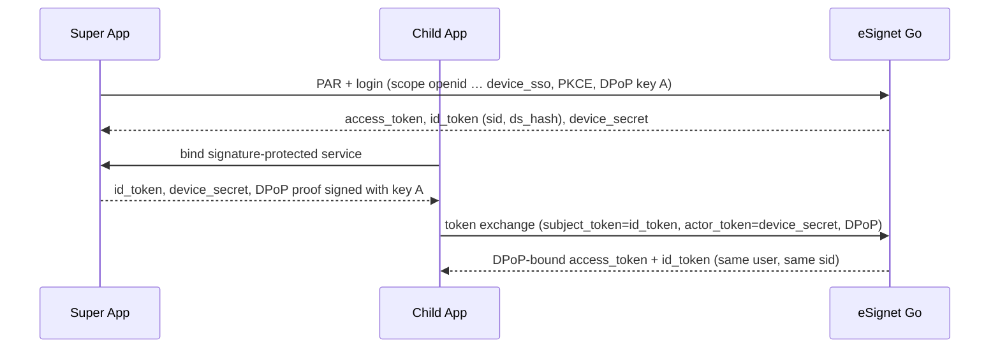

# Native SSO for eSignet Go

**MOSIP Decode 2026 · Problem statement 03: Enable Native SSO in eSignet Go for Mobile Apps · Team F4_Dhurandars**

Sign in once in a vendor's **Super App** with eSignet (UIN + OTP), and every other app from the same vendor
on that device (**Child App**) signs in **silently**, with no UIN, no OTP and no consent screen. This
implements [OpenID Connect Native SSO for Mobile Apps 1.0](https://openid.net/specs/openid-connect-native-sso-1_0.html)
in eSignet Go on top of its FAPI 2.0 profile (PAR, PKCE, DPoP, `private_key_jwt`), without weakening it.

| Where | What |
|---|---|
| [`3-pi-radians/esignet` @ `native-sso`](https://github.com/3-pi-radians/esignet/tree/native-sso) | eSignet changes as commits on `mosip/esignet` `develop-go` (best place to read the diff) |
| [`3-pi-radians/thunderid` @ `native-sso`](https://github.com/3-pi-radians/thunderid/tree/native-sso) | ThunderID engine changes on the commit eSignet pins |
| This repository | Android apps, demo environment, patches and a readable copy of every changed backend file |

---

## How it works



1. **`device_sso` scope.** Only clients registered for it (`allowed_authorization_scopes`) may request it, and only with `openid`.
2. **Device secret.** On the authorization-code grant eSignet issues a JWT that is **signed (ES256) and then encrypted** (RSA-OAEP-256 / A256GCM) with keys from eSignet's key manager. It carries the user, session (`auth_id`), original client, granted scope, acr, consented claims and `cnf.jkt` (the Super App's DPoP key).
3. **Binding.** The ID token carries `sid` and `ds_hash = BASE64URL(SHA-256(device_secret))`.
4. **Handoff.** The Super App exposes an AIDL service behind a `signature`-level permission. It checks that the caller is an allow-listed package with the same signing certificate, then returns the ID token, the device secret and DPoP proofs. Key A never leaves the Android Keystore.
5. **Token exchange (RFC 8693).** eSignet checks the device secret, the ID token (signature, issuer, audience), `ds_hash`, `sid` and `sub`, and that the DPoP key equals `cnf.jkt`. It also checks that the Child App is listed in `device_sso_allowed_clients` and belongs to the same relying party, and that the requested scope is a subset of the original grant. `device_sso` is rejected here. It then issues DPoP-bound tokens.
6. **Re-consent (bonus).** A scope beyond the original grant returns `interaction_required`; the Child App then runs a normal authorization request with `prompt=consent` and the user decides on eSignet's consent screen.

Design choices worth knowing:
- The ID token's expiry is not enforced on exchange: eSignet ID tokens live 120 s, and the device secret carries the session lifetime (default 24 h).
- Child App tokens are bound to the Super App's key, so signing out of the Super App ends sibling sessions.

## Repository layout

```
patches/            git am-ready commits for mosip/esignet and thunder-id/thunderid
upstream/           the changed eSignet and ThunderID files, for reading on GitHub
scripts/setup-workspace.sh   clones both upstreams at the pinned commits and applies patches/
mobile/             Android (Kotlin) project
  nssocore/         shared library: JOSE, DPoP, PKCE, Keystore keys, encrypted store, OAuth client, AIDL contract
  superapp/         Super App: eSignet login, device secret, SSO signing service
  childapp/         Child App: Native SSO token exchange, re-consent fallback
demo/
  local/start.sh, stop.sh   Docker-free local stack (PostgreSQL, eSignet, login UI)
  identity-stub/            local test double for the mock identity system (synthetic data)
  register-clients.sh       registers both apps using the public keys they generate
```

### Backend changes

**ThunderID** (`backend/`)
- New `DeviceSecretProvider` extension point: `pkg/thunderidengine/providers`.
- Grant handlers in `internal/oauth/oauth2/granthandlers/`:
  - `native_sso.go`: issues the device secret on the authorization-code grant.
  - `native_sso_exchange.go`: the Native SSO branch of token exchange.
- `device_sso` checks at `/authorize` and `/par`.
- `sid` and `ds_hash` claims in the ID token.

**eSignet** (`esignet-service/`)
- `internal/engine/device_secret_provider.go`: device secret format, signing and encryption, session state, client-family policy.
- Client management accepts the token-exchange grant and `device_sso_allowed_clients`.
- `MOSIP_ESIGNET_DEVICE_SECRET_EXPIRY_SECONDS` setting.
- Grant and scope configuration in `deployment.yaml`.
- `api-test/cmd/nativesso`: live end-to-end test.
- A **Native SSO** folder in the Postman collection.

## Quick start

**Prerequisites:**
- Go 1.27
- PostgreSQL 16+ (`initdb`, `pg_ctl`, `psql`)
- Node.js 18+
- JDK 17 or 21
- Android SDK 34, with an emulator or a phone (USB debugging)

```bash
git clone https://github.com/3-pi-radians/esignet-native-sso.git
cd esignet-native-sso
scripts/setup-workspace.sh        # creates esignet/ and thunderid/ on a native-sso branch
demo/local/start.sh               # eSignet :8088, login UI :3000 (stop: demo/local/stop.sh)
curl -s http://localhost:8088/.well-known/openid-configuration | grep -o device_sso
```

Build and install the apps:

```bash
cd mobile
echo "sdk.dir=$ANDROID_HOME" > local.properties
./gradlew :nssocore:testDebugUnitTest :superapp:assembleDebug :childapp:assembleDebug
adb reverse tcp:8088 tcp:8088 && adb reverse tcp:3000 tcp:3000
adb install -r superapp/build/outputs/apk/debug/superapp-debug.apk
adb install -r childapp/build/outputs/apk/debug/childapp-debug.apk
# open each app once (it creates its client key), then:
cd .. && demo/register-clients.sh # RESET=1 after reinstalling the apps
```

Both apps must be signed with the **same certificate**. Debug builds on one machine already are. For release builds, see `mobile/keystore.properties.example`; keystores are never committed.

### Demo flow

| Step | Expected |
|---|---|
| Super App → **Sign in with eSignet** → UIN `8267411571`, OTP `111111` (test hCaptcha: tick the box) → Allow | Signed in, "Native SSO: enabled" |
| Child App → **Sign in** | Signed in instantly, same subject and session id, no OTP |
| Child App → Sign out → **Sign in (also request phone)** | Re-consent prompt; "Review on eSignet" shows the consent screen with Phone Number |
| Super App → Sign out, then Child App → Sign in | "Sign in to the eSignet Super App first." |

The test identity is synthetic (no real personal data).

## Tests

```bash
(cd thunderid/backend && go test ./internal/oauth/... ./pkg/... ./cmd/...)
(cd esignet/esignet-service && CGO_ENABLED=0 go test ./...)
(cd esignet/api-test && ESIGNET_LOG=../../demo/.run/esignet.log go run ./cmd/nativesso)  # needs start.sh, ~3 min
```

| Suite | Result |
|---|---|
| ThunderID unit tests | 66 new passing results; all OAuth/engine packages pass |
| eSignet unit tests | 23 new tests; all 27 packages pass |
| Android unit tests (`nssocore`) | 10/10 |
| Live end-to-end API test | 36/36 checks. Covers silent sign-in, sign-in after the ID token expired, wrong DPoP key, missing proof, tampered/expired secret, other vendor, other relying party, `device_sso` on exchange, scope escalation, replay, and no secrets in logs |
| Postman, Native SSO folder (22 requests) | 93/93 assertions |
| Android 14 emulator | 9/9 scenarios, including re-consent |

## API summary

Native SSO token exchange (Child App):

```http
POST /oauth2/token
DPoP: <proof signed with the Super App's key A>

grant_type=urn:ietf:params:oauth:grant-type:token-exchange
&subject_token=<Super App id_token>&subject_token_type=urn:ietf:params:oauth:token-type:id_token
&actor_token=<device_secret>&actor_token_type=urn:openid:params:token-type:device-secret
&audience=<issuer>&scope=openid email
&client_id=…&client_assertion_type=urn:ietf:params:oauth:client-assertion-type:jwt-bearer&client_assertion=…
```

| Error | Meaning |
|---|---|
| `interaction_required` | Scope not granted to the Super App; user consent needed |
| `invalid_grant` | Device secret invalid, expired or revoked; client not in the vendor family; DPoP key or ID-token binding mismatch |
| `invalid_scope` | `device_sso` on exchange, `openid` missing, scope not allowed for the client |
| `invalid_dpop_proof` | DPoP proof missing or invalid |

Full request/response documentation, the design document (architecture, flows, threat model) and the test report are in the Google Drive folder linked in the submission.

## Limitations

- No logout hook deletes the server-side Native SSO session yet. Signing out on the device deletes key A, which already makes the device secret unusable.
- Android only; no iOS apps.
- With MOSIP IDA / mock identity, the opaque KYC token is addressed to the Super App, so sibling apps receive `sub` and session claims but not that token.
- The local stack uses a small test double for the mock identity system (no Docker needed). eSignet and ThunderID run unmodified apart from the changes above.

## Standards

OpenID Connect Native SSO for Mobile Apps 1.0 · RFC 8693 (Token Exchange) · RFC 9449 (DPoP) ·
RFC 9126 (PAR) · RFC 7636 (PKCE) · RFC 7523 (`private_key_jwt`) · RFC 7638 (JWK thumbprint).
